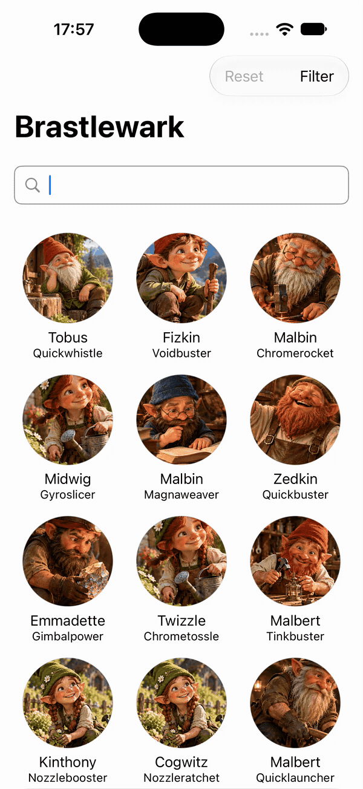

## Welcome to Brastlewark! 👋

**Brastlewark** is an iOS application that displays all the inhabitants of the gnome city of Brastlewark. Through the app, users can browse the complete city directory, search for residents by name, characteristics, or profession, and view detailed information about each resident and their friends.

The app was originally built as a technical assessment for a Senior iOS Software Engineer position. It was designed following production-level engineering practices, with a focus on scalable architecture, testability, maintainability, and a clean user experience.

  

## Table of Contents

- [Architecture and principles](#architecture-and-principles)
- [Project overview](#project-overview)
- [Layer separation](#layer-separation)
- [Navigation](#navigation)
- [Dependency Injection](#dependency-injection)
- [Accessibility](#accessibility)
- [Events tracking](#events-tracking)
- [Logging](#logging)
- [Testing](#testing)
- [CI/CD](#cicd)
- [Third-party libraries](#third-party-libraries)
- [About me](#about-me)

## Architecture and principles 💪

This project is based on a set of fundamental technical decisions and principles that guided the development of the app:

- **Clean Architecture**

The application is divided into three main layers with strict boundaries and responsibilities — Data, Domain, and Presentation — promoting a clear separation of concerns and long-term maintainability.

- **MVVM Pattern**

Views react to state changes, while view models hold state and handle user interactions. The app is entirely built with SwiftUI and uses Apple’s Observation framework, with view models adopting the `@Observable` macro.

- **SOLID Principles**

A set of key software engineering principles followed throughout the codebase — single responsibility, open/closed principle, protocol-oriented communication, and concise, clear interfaces.

- **Dependency Injection**

All components receive their required dependencies fully constructed and ready to use at initialization. This improves decoupling, configurability, and testability.

- **Layer-Specific Models**

Each layer owns its own data models, tailored specifically to its needs. Mappers are used to translate models between layers, ensuring clarity and separation of concerns.

- **Concurrency**

Asynchronous work is handled using Swift Concurrency to keep the user interface responsive and safely coordinate work across isolation boundaries. The project uses `async/await`, `Task`, actors, `@MainActor`, and `Sendable` where appropriate.

- **Error Handling**

Errors are caught and handled appropriately, offering recovery or retry options whenever possible. Each layer 
defines its own error types according to its role and purpose.

- **Protocols**

Swift protocols are extensively used to define clear, focused interfaces. This hides implementation details, encourages abstraction, and keeps layers decoupled, modular, and testable.

- **Testing**

The project includes both unit and snapshot tests to verify business logic, data transformations, presentation behavior, and visual output. This helps prevent regressions and supports safe refactoring as the application evolves.

## Project overview 🗂

The repository contains the following main directories:

- **`Brastlewark`** contains the Xcode project and the application source code.
- **`data`** contains the JSON resources and images downloaded remotely by the application.
- **`docs`** contains related documentation to this technical test and README.
- **`.github/workflows`** contains the GitHub Actions workflows used for continuous integration.

Open `Brastlewark.xcworkspace` instead of the individual `.xcodeproj` file to load the complete project and all its dependencies. The workspace includes the following:

- `Brastlewark`: the main application target and composition root.
- `AllTests`: the target used to run the complete test suite.
- `Presentation`, `Domain`, and `Data`: the Swift packages that implement each layer.

## Layer separation 📦

In Brastlewark, each layer has been defined as an independent *Swift Package* for several reasons:

- to improve compilation times
- to enforce a clear separation of concerns
- to make it easier to completely replace the implementation of a layer
- to allow work to be distributed smoothly among different teams

The main layers are `Data`, `Domain`, and `Presentation`.

### Domain

The **Domain layer** represents the core of the software system. It contains the business logic required to fulfill the application's requirements, defines the models that describe the business domain, and specifies how data is accessed without exposing implementation details.

**Use cases** encapsulate individual pieces of business logic. Each use case exposes an asynchronous `execute(params:)` method. Inputs are represented by dedicated parameter types, while the returned `Result` explicitly describes either a successful value or a domain error. Domain types involved in concurrent operations conform to `Sendable`, allowing them to safely cross concurrency boundaries.

~~~swift
public struct GetCharacterByIdUseCaseParams: Sendable {
    public let id: Int

    public init(id: Int) {
        self.id = id
    }
}

public protocol GetCharacterByIdUseCaseProtocol: Sendable {
    func execute(
        params: GetCharacterByIdUseCaseParams
    ) async -> Result<Character?, CharactersRepositoryError>
}
~~~

**Models** are implemented as value types using structs with descriptive names. They represent the entities and values relevant to the business logic and are used as inputs and outputs by the use cases. Domain models conform to `Sendable` when they need to cross concurrency boundaries.

**Repositories** define abstractions over the available data sources. They allow use cases to access and modify data without knowing whether it comes from the network, persistent storage, a cache, or another implementation. Repository interfaces use Domain models for their inputs and outputs.

~~~swift
public protocol FilterRepositoryProtocol: Sendable {
    func getAvailableFilter(fromCharacters: [Character]) async throws -> Filter
    func saveActiveFilter(_ filter: Filter) async throws
    func getActiveFilter() async throws -> Filter?
    func deleteActiveFilter() async throws
}
~~~

**Errors** are declared as `enum` types conforming to `Error` and `Sendable`. Repository-specific errors describe the failures that can be handled by the Domain and Presentation layers, while use cases can define additional business-specific errors when required.

~~~swift
public enum FilterRepositoryError: Error, Sendable {
    case noInternetConnection
    case unableToSaveFilter
    case unableToFetchFilter
    case unableToDeleteFilter
}
~~~

### Data

The **Data layer** is responsible for providing the data required by the use cases in the Domain layer. It interacts with different data sources, such as remote services, local resources, caches, and persistent storage. This layer also contains the concrete implementations of the repository interfaces declared in Domain.

All **repositories** are implemented in this layer as concrete types that conform to Domain protocols. Each repository coordinates the appropriate data sources, maps Data entities into Domain models, and translates infrastructure errors into errors understood by the Domain layer.

Data can be loaded from either a remote JSON file or a JSON resource bundled with the app. Remote data is retrieved using `URLSession` and Swift Concurrency. The network service validates connectivity, URLs, HTTP responses, and decoded content. It also supports retrying requests when transport errors occur.

**Persistent storage**, which acts as a cache, is implemented using SwiftData. Cached data is reused while its validity period has not expired and can be bypassed when a forced refresh is requested.

~~~swift
protocol CharactersCacheProtocol: Sendable {
    func get() async -> [CharacterEntity]?
    func save(_ characters: [CharacterEntity]) async
    func isValid() async -> Bool
    func clearCache() async
}

@ModelActor
final actor PersistentCharactersCache: CharactersCacheProtocol {
    // SwiftData cache implementation
}
~~~

**Entities** represent the models used internally by the Data layer. They describe the structure of external and persisted data and are translated into Domain models using dedicated mappers.

~~~swift
struct CharacterEntityMapper {
    static func map(entity: CharacterEntity) -> Character {
        Character(
            id: entity.id,
            name: entity.name,
            thumbnail: entity.thumbnail,
            age: entity.age,
            weight: entity.weight,
            height: entity.height,
            hairColor: entity.hairColor,
            professions: entity.professions,
            friends: entity.friends
        )
    }
}
~~~

### Presentation

The **Presentation layer** handles all user interface concerns. It enables users to interact with the app and delegates business logic and data requests to the use cases defined in the Domain layer.

All **views** are built using SwiftUI. They store their view models using `@State` and automatically refresh when the properties accessed by the view change. Bindings to observable properties are created locally with `@Bindable` when required.

Views communicate user interactions back to their view models and use SwiftUI previews to represent and validate different interface states during development.

~~~swift
public struct HomeView<ViewModel: HomeViewModelProtocol>: View {
    @State private var viewModel: ViewModel

    public init(viewModel: ViewModel) {
        _viewModel = State(initialValue: viewModel)
    }

    public var body: some View {
        VStack(spacing: 0) {
            searchBar
            contentView
        }
        .task {
            viewModel.viewIsReady()
        }
    }
}

private extension HomeView {
    @ViewBuilder
    var contentView: some View {
        switch viewModel.state {
        case .loading:
            loadingView
        case .ready(let characters, _):
            readyView(characters: characters)
        case .empty:
            emptyView
        case .error(let error):
            errorView(error: error)
        }
    }
}
~~~

**View models** encapsulate Presentation logic. They handle user interactions, manage view state, and expose the data required by their views.

View models use Apple’s Observation framework and adopt the `@Observable` macro. They are isolated to the main actor because their observable state directly drives the user interface. Properties that should not trigger view updates, such as dependencies and internal tasks, use `@ObservationIgnored`.

~~~swift
@MainActor
public protocol HomeViewModelProtocol: AnyObject, Observable {
    var state: HomeState { get }
    var searchText: String { get set }

    func viewIsReady()
    func didSelectCharacter(_ character: CharacterUIModel)
    func didTapFilterButton()
    func didTapResetButton()
    func didSearchTextChanged()
    func didRefreshCharacters()
}

@MainActor
@Observable
public final class HomeViewModel: HomeViewModelProtocol {
    public var state: HomeState = .loading
    public var searchText = "" {
        didSet {
            scheduleSearch(for: searchText)
        }
    }

    @ObservationIgnored private(set) var needsReload = true
    @ObservationIgnored private var searchTask: Task<Void, Never>?
    @ObservationIgnored private var loadTask: Task<Void, Never>?
}
~~~

View models interact with the Domain layer exclusively through **use cases**, which return Domain models and errors. The view model translates Domain models into lightweight `UIModel` structs containing only the data required by the view.

Domain errors are also transformed into user-facing, localized states. This keeps infrastructure and business concerns outside the view while allowing the interface to provide appropriate feedback and recovery options.

Finally, view models manage navigation through an injected **router**. When a navigation action occurs, the router updates the application’s navigation state, and the main app target constructs the corresponding destination. This keeps navigation decisions outside SwiftUI views and makes them easier to test.

### App target

The final layer in this Xcode project is the **main target**, which represents the application itself. It serves as the entry point when the app is launched. Since it has visibility into all the layers in the project, it is responsible for assembling the different components and establishing communication between them through dependency injection.

Additionally, the main target handles the app’s navigation structure and UI flow.

## Navigation 🌎

Navigation is managed through an injected `Router`, keeping navigation decisions outside SwiftUI views. View models request navigation by calling methods such as `navigate(to:)`, `navigateBack()`, or `navigateToRoot()` without needing to know how destinations are constructed or presented.

The router uses Apple’s Observation framework.

~~~swift
@MainActor
public protocol RouterProtocol: AnyObject {
    var path: NavigationPath { get set }

    func navigate(to route: Route)
    func navigateBack()
    func navigateToRoot()
    func popToView(count: Int)
    func canNavigateBack() -> Bool
}

@MainActor
@Observable
public final class Router: RouterProtocol {
    public var path = NavigationPath()

    public init() {}

    public func navigate(to route: Route) {
        path.append(route)
    }

    public func navigateBack() {
        path.removeLast()
    }

    public func navigateToRoot() {
        path.removeLast(path.count)
    }

    public func popToView(count: Int) {
        path.removeLast(count)
    }

    public func canNavigateBack() -> Bool {
        !path.isEmpty
    }
}
~~~

Available destinations are represented by a strongly typed `Route` enum. Each case contains the information required to configure its destination.

~~~swift
public enum Route: Hashable {
    case filter
    case details(characterId: Int, showHome: Bool)
}
~~~

Destination construction is centralized in the app’s composition root through `navigationDestination(for:)`. This gives the main target responsibility for assembling views and their dependencies while keeping the Presentation layer decoupled from the concrete navigation setup.

~~~swift
@State private var router: Router

var body: some Scene {
    WindowGroup {
        @Bindable var router = router

        NavigationStack(path: $router.path) {
            HomeView(viewModel: homeViewModel)
                .navigationDestination(for: Route.self) { route in
                    switch route {
                    case .filter:
                        FilterView(viewModel: filterViewModel)

                    case .details(let characterId, let showHome):
                        DetailsView(
                            characterId: characterId,
                            showHome: showHome,
                            viewModel: detailsViewModel
                        )
                    }
                }
        }
    }
}
~~~

## Dependency Injection 💫

Dependency injection is a fundamental mechanism for achieving a truly **Clean Architecture**, where each component receives its fully configured, ready-to-use dependencies without needing to know how they are created or where they come from. In addition, injected dependencies significantly simplify **testing and mocking**.

In Brastlewark, dependency injection is handled using a popular third-party library called [Swinject](https://github.com/Swinject/Swinject). Each layer has its own `Module` file, where all its components are declared, instantiated, and configured for use.

Finally, the app’s main target is responsible for executing all dependency injection modules, assembling the application, and wiring together the components involved in the app’s lifecycle.

~~~swift
@MainActor
public enum DIContainer {
    private static let dataSource: DataModule.Source = .local

    public static let shared: Container = {
        let container = Container()
        DataModule.registerDependencies(
            inContainer: container,
            source: dataSource
        )
        DomainModule.registerDependencies(inContainer: container)
        PresentationModule.registerDependencies(inContainer: container)
        return container
    }()
}
~~~

## Accessibility 👀

To ensure that all users can interact with the app without barriers, Brastlewark takes advantage of SwiftUI’s built-in accessibility features. The app supports Apple’s VoiceOver and other assistive technologies by using appropriate accessibility elements.

Modifiers such as `accessibilityLabel`, `accessibilityHint`, `accessibilityValue`, and `accessibilityAction` are implemented thoughtfully according to the purpose and behavior of each UI element.

## Events tracking 📊

Tracking user interactions and events is essential for understanding how well the app is performing and whether it is fulfilling its purpose. In Brastlewark, each view model receives an instance of a `Tracker` class, which defines all the relevant events for that particular feature.

~~~swift
public enum HomeTrackingEvent: Sendable {
    case screenViewed
    case searchChanged(text: String)
    case filterTapped
    case resetTapped
    case refreshed
    case characterSelected(characterId: Int)
    case emptyScreenViewed
    case errorScreenViewed
}
~~~

The app also defines an `AnalyticsProtocol` that is ready to be implemented using any preferred analytics or event-tracking framework.

## Logging 💬

The project includes a centralized logging system built on top of Apple’s `OSLog` framework. The shared implementation lives in the **Utils** package, while each application layer — Presentation, Domain, and Data — defines its own categories and logging interface.

Each log entry includes a layer-specific prefix, its source, its category, and an appropriate severity level: `debug`, `info`, `notice`, `warning`, `error`, or `fault`.

Logging can be enabled or disabled globally or for individual categories through `AppLog.configuration`.

~~~swift
AppLog.configuration.disable(DataLog.network.category)
AppLog.configuration.enable(DataLog.network.category)

AppLog.configuration.disableAll()
AppLog.configuration.enableAll()
~~~

## Testing 🤓

Proper test coverage is essential for building high-quality software. Tests ensure that the system meets its requirements, behaves as expected, and helps prevent regressions when inevitable changes occur.

Testing in Brastlewark follows two main approaches: **unit testing** and **snapshot-based UI testing**. Additionally, all SwiftUI views include `.accessibilityIdentifier()` modifiers, allowing testing tools to reliably locate and verify UI elements in the Presentation layer.

### Unit tests

Unit tests verify that small, isolated pieces of code work correctly — typically methods and functions. To achieve this, a wide range of `Mock` classes and structs are implemented across all layers, allowing different scenarios to be simulated.

Unit testing in this project focuses primarily on the app’s core components: **view models**, **use cases**, **repositories**, **mappers**, and any additional logic or helpers used throughout its features.

Tests are implemented using Apple’s native frameworks: the modern `Testing` framework and the reliable, well-established `XCTest`. All test cases follow a standard *given-when-then* structure.

### Snapshot tests

Snapshot testing ensures that UI elements render as expected on the device screen. This technique compares screenshots taken during test execution with pre-approved reference images, which serve as the source of truth for the expected appearance.

The project uses Point-Free’s [SnapshotTesting](https://github.com/pointfreeco/swift-snapshot-testing) library for snapshot testing.

## CI/CD 🚀

The repository includes a continuous integration workflow for **GitHub Actions**, defined in `.github/workflows/ci.yml`. The workflow runs automatically for every pull request and every push to the `main` branch.

The workflow is divided into independent jobs:

- **Build**: compiles the application.
- **Unit tests**: run the test suites for the Utils, Domain, Data, and Presentation packages.
- **Snapshot tests**: run the application’s snapshot test suite.

## Third-party libraries 📚

The Brastlewark app uses the following third-party libraries through Swift Package Manager:

- [MultiSlider](https://github.com/yonat/MultiSlider): provides the range sliders used in the filter view.
- [Swinject](https://github.com/Swinject/Swinject): provides dependency injection across the app.
- [SnapshotTesting](https://github.com/pointfreeco/swift-snapshot-testing): provides snapshot-based UI testing.
- [SwiftLint](https://github.com/realm/SwiftLint): enforces Swift style and coding conventions.

## About me 🙋♂

**Jaime Aranaz**  
*Freelance Senior iOS developer*  
jaime.aranaz@gmail.com  
📍 Madrid, Spain  

- [LinkedIn](https://www.linkedin.com/in/jaimearanaztudela/)
- [X](https://x.com/JaimeAranaz)
